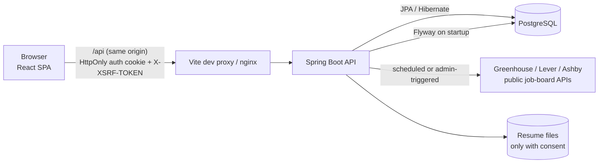
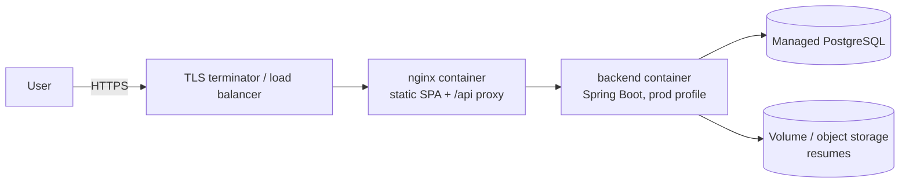

# JobPulse architecture

## 1. System overview



**A modular monolith.** One Spring Boot application and one database. The features (jobs, applications, profiles, employers, admin, ingestion, matching) share a transaction boundary and a schema, which keeps consistency simple: applying to a job and writing its history row happen in one transaction. Splitting into microservices would add network calls, distributed transactions and deployment work without solving any problem this product has.

**Request path inside the API:**

```
HTTP → Security filter chain (rate limit → JWT cookie → CSRF → URL role rules)
     → Controller (validates DTO, reads principal id)
     → Service (@Transactional: business rules + ownership checks)
     → Repository (Spring Data JPA: derived queries, JPQL, Specifications)
     → Mapper → DTO record → JSON
Errors anywhere → GlobalExceptionHandler / JsonSecurityErrorHandler → ApiError JSON
```

Each layer has one job:
- **Controllers** contain no business logic. They turn HTTP into method calls and pick status codes (201 + `Location` for creates, 204 for idempotent save/unsave).
- **Services** own the rules ("can't apply to a closed job", "an employer can't withdraw") and the transactions.
- **Repositories** only fetch and store data.
- **Entities** never leave the service layer. Controllers return DTO records only.

## 2. Data model

```mermaid
erDiagram
    USERS ||--o| CANDIDATE_PROFILES : "has (candidates)"
    USERS ||--o| COMPANIES : "owns (employers)"
    CANDIDATE_PROFILES ||--o{ EDUCATIONS : has
    CANDIDATE_PROFILES ||--o{ WORK_EXPERIENCES : has
    CANDIDATE_PROFILES ||--o{ CANDIDATE_SKILLS : has
    CANDIDATE_PROFILES ||--o{ RESUMES : uploads
    SKILLS ||--o{ CANDIDATE_SKILLS : ""
    SKILLS ||--o{ JOB_SKILLS : ""
    COMPANIES ||--o{ JOBS : lists
    JOB_SOURCES ||--o{ JOBS : "imported from"
    USERS ||--o{ JOBS : "posted_by"
    JOBS ||--o{ JOB_SKILLS : requires
    JOBS ||--o{ JOB_VERIFICATIONS : "checked by"
    USERS ||--o{ SAVED_JOBS : bookmarks
    JOBS ||--o{ SAVED_JOBS : ""
    USERS ||--o{ APPLICATIONS : submits
    JOBS ||--o{ APPLICATIONS : receives
    APPLICATIONS ||--o{ APPLICATION_STATUS_CHANGES : "audit trail"
    USERS ||--o{ MATCH_SCORES : ""
    JOBS ||--o{ MATCH_SCORES : ""
    USERS ||--o{ SKILL_GAPS : ""

    USERS { uuid id PK; string email UK; string password_hash; string role "CANDIDATE|EMPLOYER|ADMIN"; bool is_active }
    COMPANIES { uuid id PK; string name; string normalized_name UK; uuid owner_id FK "UK, nullable" }
    JOBS { uuid id PK; string origin "INGESTED|EMPLOYER"; uuid company_id FK; string title; string status; timestamptz posted_at; numeric salary_min; numeric salary_max }
    APPLICATIONS { uuid id PK; uuid user_id FK; uuid job_id FK; string status; timestamptz applied_at; timestamptz interview_at; text cover_letter; text notes }
    APPLICATION_STATUS_CHANGES { uuid id PK; uuid application_id FK; string from_status; string to_status; uuid changed_by_id FK; string note }
    SAVED_JOBS { uuid id PK; uuid user_id FK; uuid job_id FK }
```

Constraints that carry business meaning:

| Constraint | Why |
| --- | --- |
| `applications UNIQUE (user_id, job_id)` | One application per candidate per job. The service checks first and returns a friendly 409. The constraint catches the race when two requests arrive at once (also reported as 409). |
| `saved_jobs UNIQUE (user_id, job_id)` | Makes saving idempotent. |
| `companies UNIQUE (owner_id) WHERE owner_id IS NOT NULL` | One company per employer account. Ingested companies have no owner. |
| `chk_applications_status`, `chk_jobs_status`, `chk_users_role` | The database rejects invalid enum strings even if a bug got past the Java enums. |
| `chk_jobs_salary`, `chk_education_years`, `chk_experience_dates` | Ranges must be ordered, the same rules as Bean Validation. |
| `chk_jobs_ingested_has_source` | An imported job must keep its source, external id and apply URL. |

The schema belongs to **Flyway** (`db/migration/V1..V4`). Hibernate runs with `ddl-auto: validate`, so it only checks that the entities match the schema and never changes it. V3 and V4 show how the schema evolves without losing data. For example, V4 moves old `SAVED`/`PLANNING` application rows into `saved_jobs` before it adds the new status constraint.

## 3. Authentication and authorization

### Flow

```mermaid
sequenceDiagram
    participant SPA
    participant API
    participant DB
    SPA->>API: GET /api/auth/csrf
    API-->>SPA: Set-Cookie XSRF-TOKEN (readable by JS)
    SPA->>API: POST /api/auth/login {email, password}<br/>X-XSRF-TOKEN: <token>
    API->>DB: load user by email
    API->>API: BCrypt.matches(password, hash)
    API-->>SPA: 200 user JSON + Set-Cookie JOBPULSE_AUTH=<JWT>; HttpOnly; SameSite=Lax
    SPA->>API: GET /api/dashboard (cookie sent automatically)
    API->>API: JwtAuthFilter: verify signature + expiry → user id
    API->>DB: load user (role, is_active)
    API-->>SPA: 200 dashboard
```

### Why a JWT in an HttpOnly cookie
- **HttpOnly** means page JavaScript can't read the token, so an XSS bug can't steal the session. Keeping a token in `localStorage` would expose it to any injected script.
- **Stateless:** no session table. The token holds only the user id, signed with HMAC-SHA256.
- **The role isn't trusted from the token.** The filter reloads the user on every request, so a role change or deactivation takes effect on the very next request. The cost is one primary-key lookup per request, which is cheap at this scale and buys immediate revocation.

### CSRF
Browsers attach cookies automatically, so cookie auth needs CSRF protection. There are two layers:
1. `SameSite=Lax` on the auth cookie: browsers don't send it on cross-site POSTs.
2. Spring Security's double-submit token: `XSRF-TOKEN` is a readable cookie, and every write must echo it back in the `X-XSRF-TOKEN` header. Another site can make a browser *send* our cookies, but it can't *read* them to build the header. `SpaCsrfTokenRequestHandler` follows Spring's documented SPA setup. The frontend retries once with a fresh token if the server answers `CSRF_INVALID`.

Login is CSRF-protected too, which prevents "login CSRF" (signing a victim into an attacker's account).

### Authorization, in two layers
1. **Role, per URL** (`SecurityConfig`): `/api/employer/**` requires EMPLOYER, `/api/admin/**` requires ADMIN, and candidate-data endpoints require CANDIDATE. Public: job search and detail, companies, skills, auth.
2. **Ownership, per row** (services): `ApplicationService.findOwned`, `EmployerService.ownedJob`, `ownedApplication`. A role check can't tell *your* application from someone else's. Foreign ids return **404, not 403**, so the API never confirms that someone else's resource exists.

The React route guards (`RequireRole`) are there for user experience only. The backend never relies on them.

### Other protections
- BCrypt password hashes, never plain text. Passwords are capped at 72 characters because BCrypt ignores anything longer.
- An admin can't self-register: `RegisterRequest` rejects the ADMIN role. The first admin comes from `ADMIN_EMAIL`/`ADMIN_PASSWORD` at startup (`AdminBootstrap`).
- Login and registration are rate-limited per IP (10 per minute, then 429) by `AuthRateLimitFilter`.
- `JWT_SECRET` must be at least 32 bytes, or the app won't start.

## 4. JPA and query design

**Every `@ManyToOne` and `@OneToOne` is `FetchType.LAZY`.** The JPA default is EAGER, which loads the company, source, user and so on for every job, whether or not it's needed. With LAZY, each query states what it needs:
- `@EntityGraph(attributePaths = "company")` or `join fetch` when a page shows the company name.
- Specification search: `root.fetch("company")` for the page query, a plain join for the `count(*)` query (a count query can't contain a fetch).

**N+1 prevention.** `JobSummaryAssembler` builds a page of job cards with exactly three extra queries, however many jobs there are:
1. the skill names for all job ids (`… where js.job.id in :ids`, a constructor projection);
2. which of those jobs the user has saved;
3. the user's cached match scores for those jobs.

The employer applicant list does the same: one query for the profiles and one for the skills of all applicants on the page. `hibernate.default_batch_fetch_size: 50` is a safety net for any lazy collection that's still touched in a loop.

**`open-in-view: false`.** Lazy loading can't happen while JSON is being rendered. Services return fully built DTOs inside their transaction, so a missing fetch fails loudly in tests instead of quietly firing queries from the view layer.

**Owned collections.** `CandidateProfile` owns its `educations`, `experiences` and `skills` with `cascade = ALL, orphanRemoval = true`. A profile save *reconciles* the lists by id rather than deleting everything and re-inserting. Hibernate flushes INSERTs before DELETEs, so "clear and re-add the same skill" would break the `(profile, skill)` unique constraint. Reconciling avoids that and keeps unchanged rows untouched.

**Constructor projections** (`Projections.java`) return just the columns a screen needs, e.g. the company list's per-company counts in **one** grouped query:
```sql
select c.id, c.name, count(j.id), sum(case when j.employment_type='INTERNSHIP' then 1 else 0 end) …
from companies c left join jobs j on j.company_id = c.id and j.status = 'ACTIVE'
group by c.id … order by count(j.id) desc
```

## 5. DTOs, validation, errors and transactions

- **DTOs are Java records.** They're immutable and have no behaviour. Request records carry Bean Validation (`@NotBlank`, `@Size`, `@Email`, `@Pattern`, `@Future`), plus cross-field rules written as `@AssertTrue` methods ("min salary ≤ max salary", "employers need a company name"). Response records never include internal fields such as the password hash or a candidate's private notes on the employer side.
- **One error format:** `ApiError {timestamp, status, code, message, path, fieldErrors}`.

| Exception | HTTP | `code` |
| --- | --- | --- |
| Bean Validation failure | 400 | `VALIDATION_ERROR` (with `fieldErrors`) |
| `ResourceNotFoundException` | 404 | `NOT_FOUND` |
| `DuplicateResourceException`, unique-constraint race | 409 | `CONFLICT` |
| `BusinessRuleException` (e.g. invalid status move) | 422 | `BUSINESS_RULE` |
| Bad password / disabled account | 401 / 403 | `BAD_CREDENTIALS` / `ACCOUNT_DISABLED` |
| Not signed in / wrong role / bad CSRF token | 401 / 403 / 403 | `UNAUTHENTICATED` / `FORBIDDEN` / `CSRF_INVALID` |
| Anything unexpected | 500 | `INTERNAL_ERROR`, with the stack trace logged and nothing leaked |

- **Transactions.** `@Transactional` sits on service methods, and read-only methods use `readOnly = true`, so Hibernate skips dirty checking. "Apply" creates the application and its first history row in one transaction (the history row is saved through cascade). Ingestion puts each job's upsert in its own transaction inside a separate bean (`JobUpsertService`). A call from one method to another on the same object bypasses Spring's transactional proxy, so the separate bean is needed for the per-job transaction to actually apply, and one bad record can't roll back the whole board.
- **The application state machine** lives in `ApplicationStatus.allowedNext()`, and `ApplicationWorkflow` is the only place that applies transitions. Candidate and employer services share it but decide *who* may do *what*: employers can't withdraw; candidates can only withdraw on employer-managed applications but track every stage themselves on external ones.

## 6. Indexing, pagination and performance

| Index | Serves |
| --- | --- |
| `jobs (status, posted_at DESC)` | The default search: active jobs, newest first. It replaced a status-only index. |
| `jobs (company_id)`, `jobs (posted_by_id)` | Company pages and the employer workspace |
| `applications (user_id, status)`, `applications (job_id, status)` | The candidate tracker, and the employer's applicant tabs |
| partial `applications (user_id, interview_at) WHERE interview_at IS NOT NULL` | Upcoming interviews |
| `saved_jobs (user_id, created_at DESC)` | Saved jobs, newest first |
| FK indexes on `candidate_skills`, `job_skills (skill_id)`, `educations`, `work_experiences`, `resumes` | Joins (Postgres doesn't index foreign keys automatically) |

- **Pagination:** every list is paged (`PageRequest`), with page size capped at 50 by validation. Responses use a stable `PageResponse` DTO rather than serializing Spring's `Page`.
- **Stable ordering:** search sorts with NULLs last (a `CASE` expression, because Postgres puts NULLs first in DESC order), then `created_at`, then `id` as a tie-breaker, so the same row can't show up on two pages.
- **Keyword search** is `ILIKE`-style matching on title, company and description, with user wildcards escaped. That's fine at thousands of rows. At larger scale the next step is a `pg_trgm` GIN index or Postgres full-text search (`tsvector`), still without a separate search engine.
- **Match scores** are cached per (user, job) for 6 hours and deleted when the profile changes, so a score never reflects an old profile.

## 7. Security review

| Risk | Mitigation |
| --- | --- |
| Credential theft | BCrypt hashes, HTTPS-only `Secure` cookies in prod, login rate limiting |
| XSS stealing the session | HttpOnly cookie. React escapes output by default. Imported HTML descriptions are converted to text, never injected with `dangerouslySetInnerHTML`. |
| CSRF | SameSite=Lax plus the double-submit token on every write |
| SQL injection | Only bound parameters: JPQL parameters, Criteria API, derived queries. No string-built SQL. LIKE wildcards are escaped. |
| Broken access control (IDOR) | Ownership checks in services, with 404 for foreign ids. Integration tests try other users' ids directly. |
| Privilege escalation | ADMIN can't be self-registered. Roles come from the DB on every request, never from the client. |
| Sensitive data exposure | DTOs never include password hashes. Candidate notes are private. 500s return a generic message. `server.error.include-*` is off. |
| Path traversal on upload | Filenames are sanitized and the resolved path must stay inside the user's directory. Only PDF/DOCX up to 5 MB. Nothing is stored without consent. |
| Open redirect | `?next=` after login only accepts same-site paths (`/…`, not `//…`). |
| Secrets in git | `.env` is gitignored, `.env.example` templates are committed, and the app refuses to start without `JWT_SECRET`. |
| Clickjacking / MIME sniffing | nginx sends `X-Frame-Options: DENY` and `X-Content-Type-Options: nosniff`. |

Open items: no per-session revocation (a stolen cookie stays valid until it expires unless the user is deactivated), the rate limiter is per instance, and there's no Content-Security-Policy header yet.

## 8. Testing strategy

| Level | What | How |
| --- | --- | --- |
| Unit (pure logic) | `ApplicationStatus` transitions, `ApplicationWorkflow` (interview rules), profile completeness weights, LIKE escaping, skill word-matching, rate limiter with a controllable `Clock` | JUnit 5, no Spring |
| Unit (service decisions) | `ApplicationService`: 404 vs 409 vs 422, clock-based `appliedAt`, cover letter trimming | Mockito mocks for repositories |
| Integration | Auth (cookie flags, CSRF rejection, validation errors, admin self-registration blocked), search filters/pagination/escaping on real SQL, the full apply → employer review → interview → dashboard flow, ownership 404s, role 403s, withdraw and re-apply, profile reconciliation, deactivation cutting off a live session | `@SpringBootTest` + MockMvc + **embedded PostgreSQL**, with Flyway migrations applied |
| Frontend unit | URL ⇄ filter state round-trip, salary/time formatting, CSRF cookie parsing, query building | Vitest |
| End to end (manual, recorded) | The 10 candidate, employer and admin scenarios, run in a browser against the real API and database | See the verification log in the last session summary |

Integration tests use a real PostgreSQL rather than H2 because the schema relies on Postgres features (arrays, partial indexes, check constraints, `gen_random_uuid`). An H2 test would be testing a different database. Embedded Postgres was chosen over Testcontainers so the suite also runs on machines without Docker.

## 9. Deployment architecture



- `docker-compose.yml` runs the same three pieces locally: Postgres 16, the backend (JRE 21, non-root user, health check on `/actuator/health/readiness`) and nginx. Only nginx publishes a port.
- The `prod` profile turns on `Secure` cookies, JSON (ECS) structured logs, and switches Swagger off unless `SWAGGER_ENABLED=true`.
- Flyway migrates on startup, so deploys are "ship a new image". Migrations are written to be additive.
- To scale horizontally, the backend is stateless (JWT), so more instances can sit behind the load balancer. Two things would need to change first: the rate limiter needs a shared store, and resumes need object storage instead of a local volume.
